# 📱 Awesome Remote Device Debugging & DevTools 🛠️

> 🚀 A curated directory of top-tier **Remote Device Debugging**, **DevTools**, and **Network Traffic Inspection** platforms — featuring enterprise SaaS real-device testing clouds, native HTTP/HTTPS MITM proxies, ADB bridge utilities, and self-hosted open-source device labs for Android, iOS, and WebViews.

⭐ **Star this repository if you find it helpful!** ⭐

---

## 📋 Table of Contents

- [📊 Sector Overview & Market Dynamics](#-sector-overview--market-dynamics)
- [🟦 SaaS / Hosted Platforms](#-saas--hosted-platforms)
- [🟩 Open-Source Software](#-open-source-software)
- [⚖️ Comparison at a Glance](#️-comparison-at-a-glance)
- [💖 Support](#-support)
- [📈 Star History](#-star-history)
- [🤝 Contributing](#-contributing)
- [📄 License](#-license)

---

## 📊 Sector Overview & Market Dynamics

The global cloud testing and software debugging market is estimated at **$13 billion to $15 billion in 2026** and is projected to expand to over **$45 billion by 2034**, driven by a steady compound annual growth rate (**CAGR of ~12% to 13%**).

The sector demonstrates a **moderately fragmented and bifurcated market structure**: large-scale commercial real-device testing clouds (such as BrowserStack and Sauce Labs) dominate enterprise cross-browser CI/CD pipelines, while local HTTP/HTTPS MITM proxies (Proxyman, Charles Proxy, Fiddler) and self-hosted open-source toolkits (Device Farmer STF, mitmproxy, scrcpy, tapflow) thrive across independent developer desks and security teams demanding low latency, privacy compliance, and zero cloud lock-in.

---

## 🟦 SaaS / Hosted Platforms

Commercial, cloud-hosted remote device debugging and web inspection platforms sorted by parent company scale (revenue / market valuation, descending).

| 🏢 Platform | 💰 Company Scale (Revenue / Valuation) | 💵 Starting Tier Pricing | 🎁 Free Tier / Free Trial Limits | 🔍 Core Debugging Capabilities | 🎯 Best For |
|:---|:---|:---|:---|:---|:---|
| [**BrowserStack Remote Debugging**](https://www.browserstack.com/live) | **~$4.0 Billion Valuation** (~$250M ARR) | **$29.00** / user / month (Live Desktop & Mobile, billed annually at $348/yr; or $39 month-to-month) | **Free Trial with 100 automated mobile testing minutes** and interactive test sessions; no perpetual free tier | Interactive real-device Chrome & Safari DevTools, DOM inspection, remote console, network HAR logging, and geo-location testing | Enterprise web and QA teams seeking instant access to 3,500+ real mobile devices and browsers without hardware upkeep |
| [**Progress Fiddler Everywhere**](https://www.telerik.com/fiddler/fiddler-everywhere) | **~$1.8 Billion Market Cap** (~$1.0B TTM Revenue, NASDAQ: PRGS) | **$12.00** / user / month (Fiddler Everywhere Pro, billed annually at $144/yr) | **10-day fully functional free trial** (unlimited rule execution during trial); no permanent free tier | Cross-platform (macOS/Win/Linux) HTTPS decryption, live traffic tampering, API mocking, rule compose engine, and collaborative team workspaces | Cross-platform developers and QA engineers debugging REST/WebSocket traffic and API contracts |
| [**Sauce Labs Real Device Cloud**](https://saucelabs.com/) | **~$90M–$250M ARR** (~$270M Total Raised across Series G) | **$39.00** / month (Live cross-browser testing; Real Device Cloud starting at $199/month billed annually) | **28-day free trial** (includes 60 automated & live testing minutes and 3 parallel test lanes); no permanent free tier | Remote interactive debugging on physical Android and iOS devices, live audio/video streaming, gesture replay, and ADB tunnel | QA automation teams requiring high-concurrency mobile testing pipelines integrated with CI/CD and automated failure analysis |
| [**Proxyman**](https://proxyman.com/) | **Bootstrapped Indie ISV** (~$576K ARR, Proxyman LLC) | **$69.00** one-time purchase per seat (Personal License, includes 1 year of updates; $129 for Business License) | **Free Forever Tier limited to 1 active rule** (Breakpoints, Map Local, Map Remote capped at 1 domain/rule); 14-day full business trial | Native macOS Swift GUI, automatic 1-click certificate setup for iOS/Android emulators, SSL proxying, WebSocket & GraphQL inspector | macOS, iOS, and Android developers seeking a lightweight, modern alternative to legacy Java proxies |
| [**Charles Proxy**](https://www.charlesproxy.com/) | **Bootstrapped Micro-ISV** (Privately held, XK72 Limited) | **$50.00** one-time purchase per user license (Charles 5.x perpetual license) | **30-day free trial** (application session automatically quits after 30 minutes of continuous execution); no permanent free tier | HTTP/HTTPS SSL proxy, request throttling (modem simulation), breakpoint request/response modification, and W3C validator | Developers looking for a battle-tested cross-platform proxy for deep protocol inspection and bandwidth throttling |

---

## 🟩 Open-Source Software

Self-hosted, community-driven remote device debugging tools, device farms, terminal dashboards, and MITM proxy utilities sorted by GitHub stars (descending).

| 📦 Project | ⭐ GitHub Stars | 📜 License | 🛠️ Tech Stack | 🔍 Primary Architecture & Focus | 🎯 Best For |
|:---|:---:|:---|:---|:---|:---|
| [**Genymobile/scrcpy**](https://github.com/Genymobile/scrcpy) |  | Apache-2.0 | C / Java / ADB | Display and control Android devices over USB or TCP/IP with ultra-low latency (35~70ms) and high performance | High-performance remote Android screen mirroring, tactile interaction, and wireless clipboard/audio forwarding |
| [**mitmproxy/mitmproxy**](https://github.com/mitmproxy/mitmproxy) |  | MIT | Python / Rust | Interactive, SSL/TLS-capable intercepting proxy for HTTP/1, HTTP/2, and WebSockets with console, web, and Python API interfaces | Penetration testers, network analysts, and backend engineers inspecting mobile API calls and writing automated traffic hooks |
| [**appium/appium**](https://github.com/appium/appium) |  | Apache-2.0 | Node.js / TypeScript | Cross-platform test automation framework for native, hybrid, and mobile web apps on iOS, Android, and desktop | Automated end-to-end device testing, remote UI automation, and driver-agnostic mobile session management |
| [**liriliri/eruda**](https://github.com/liriliri/eruda) |  | MIT | JavaScript | Console, DOM tree inspector, network monitor, and storage manager running directly inside in-app mobile web browsers | In-browser frontend debugging on mobile devices when USB cables and remote devtools protocols cannot be attached |
| [**Tencent/vConsole**](https://github.com/Tencent/vConsole) |  | MIT | TypeScript | Lightweight, embeddable developer companion tool for mobile front-end web pages and hybrid mobile applications | Quick on-device logging, network inspection, and system metrics debugging within mobile web and hybrid containers |
| [**avwo/whistle**](https://github.com/avwo/whistle) |  | MIT | Node.js | Cross-platform web debugging proxy tool based on Node.js with declarative pattern-matching rules and WebSocket support | Complex HTTP/HTTPS capture, URL rewriting, mock responders, and multi-platform webview debugging |
| [**DeviceFarmer/stf**](https://github.com/DeviceFarmer/stf) |  | Apache-2.0 | Node.js / RethinkDB / ADB | Open-source Smartphone Test Farm (STF) for controlling physical Android devices remotely via a browser, with live `adb connect` tunnels | QA teams and distributed engineering orgs sharing real Android device hardware with authentic remote Chrome DevTools access |
| [**wuchangming/spy-debugger**](https://github.com/wuchangming/spy-debugger) |  | MIT | Node.js | One-stop wireless mobile network debugger supporting HTTP/HTTPS interception, page debugging, and WebView element inspection | Wireless mobile page and WebView inspection without requiring tethered USB cables |
| [**requestly/requestly**](https://github.com/requestly/requestly) |  | MIT / Elastic | TypeScript / Node.js | Open-source API and web debugging client for intercepting, modifying, and mocking network requests on browsers and mobile devices | Intercepting, redirecting, and mocking production mobile and web network traffic directly on remote devices |
| [**google/ios-webkit-debug-proxy**](https://github.com/google/ios-webkit-debug-proxy) |  | BSD-3-Clause | C | DevTools proxy that enables Chrome DevTools UI to inspect iOS Safari and UIWebViews on real devices over USB | Connecting standard DevTools protocols to real iOS devices from Linux, Windows, or macOS |
| [**RemoteDebug/remotedebug-ios-webkit-adapter**](https://github.com/RemoteDebug/remotedebug-ios-webkit-adapter) |  | MIT | TypeScript | Protocol adapter that exposes iOS WebKit Remote Debugging via the standard Chrome DevTools Protocol (CDP) | Debugging iOS Safari and hybrid apps using modern Chrome DevTools, VS Code, and Playwright |
| [**jo-duchan/tapflow**](https://github.com/jo-duchan/tapflow) |  | MIT | Node.js / WebSocket / H.264 | Self-hosted BrowserStack alternative for streaming local iOS Simulators and Android Emulators over the web with direct touch injection | In-house mobile QA teams seeking cloud-free browser access to Mac-hosted iOS and Android simulators |
| [**appium/appium-inspector**](https://github.com/appium/appium-inspector) |  | Apache-2.0 | Electron / React | Visual GUI inspector for mobile app UI hierarchies, locator generation, and live interactive device interaction | Exploring and debugging native/hybrid application DOM hierarchies and crafting automated test selectors |
| [**RockxyApp/Rockxy**](https://github.com/RockxyApp/Rockxy) |  | Open Source | Swift (macOS) | Native macOS HTTP/HTTPS debugging proxy for API inspection, response mocking, WebSocket/GraphQL debugging, and MCP agent control | macOS engineers wanting a snappy native proxy for inspecting GraphQL, WebSockets, and mock responses |
| [**HimbeersaftLP/ios-safari-remote-debug-kit**](https://github.com/HimbeersaftLP/ios-safari-remote-debug-kit) |  | Open Source | Shell / PowerShell | Free open-source alternative to inspect.dev for debugging iOS Safari and WebViews from Windows and Linux | Cross-platform web developers debugging real iPhone and iPad Safari sessions without a Mac workstation |
| [**ZaneL1u/remote-webview-debugger**](https://github.com/ZaneL1u/remote-webview-debugger) |  | Open Source | Go / WebSocket / MCP | Autonomous AI agent remote debugging bridge for mobile WebViews with consent-driven PII masking and Chrome DevTools back-channel | AI-assisted debugging of elusive end-user mobile WebView bugs directly in production apps |
| [**alanisme/adb-tui**](https://github.com/alanisme/adb-tui) |  | MIT | Go | Terminal UI dashboard and MCP server for Android Debug Bridge with 11 interactive views and 1-key wireless TCP/IP toggling | Terminal-centric developers and automated AI agents managing multi-device Android fleets |
| [**sitharaj88/nectoproxy**](https://github.com/sitharaj88/nectoproxy) |  | Open Source | Node.js / React | Open-source MITM proxy with Web UI, per-domain auto-SSL certificates, 8-action rules engine, and network conditioning | Web developers seeking an open-source Charles/Fiddler replacement with HAR export and zero license fees |

---

## ⚖️ Comparison at a Glance

| 🛠️ Software | 📜 License | 💻 Stack | 🎯 Primary Focus | 📱 Real Device Access | 🏠 Self-Hosted | 💡 Recommended For |
|:---|:---|:---|:---|:---:|:---:|:---|
| **BrowserStack** | Commercial | Cloud SaaS | Real-device cross-browser testing | ✅ Physical Cloud | ❌ | High-coverage automated & interactive enterprise QA |
| **Progress Fiddler** | Commercial | Electron / .NET | Cross-platform HTTP/HTTPS proxy | ❌ | ❌ | Windows and multi-platform network traffic tampering |
| **Sauce Labs** | Commercial | Cloud SaaS | Enterprise device cloud & automation | ✅ Physical Cloud | ❌ | High-concurrency CI/CD mobile testing suites |
| **Proxyman** | Commercial | Native Swift | macOS HTTP/HTTPS debugging proxy | ❌ (Sim/Device Proxy) | ❌ | Fast native Apple ecosystem traffic inspection |
| **Charles Proxy** | Commercial | Java | Cross-platform web debugging proxy | ❌ (Proxy only) | ❌ | Legacy cross-platform network protocol validation |
| **Genymobile/scrcpy** | Apache-2.0 | C / Java | Android screen mirror & control | ✅ Physical (USB/WiFi) | ✅ | Ultra-fast local/remote Android mirroring & input |
| **mitmproxy** | MIT | Python / Rust | Interactive terminal & web MITM proxy | ❌ (Proxy only) | ✅ | Scriptable traffic tampering and pentesting |
| **appium** | Apache-2.0 | TypeScript | Cross-platform mobile automation | ✅ Real & Virtual | ✅ | Standardized WebDriver mobile test suites |
| **Device Farmer STF** | Apache-2.0 | Node.js / ADB | Android physical device farm | ✅ Physical Android | ✅ | Distributed teams sharing a private device pool |
| **avwo/whistle** | MIT | Node.js | Multi-platform web debugging proxy | ❌ (Proxy only) | ✅ | Rule-based proxying and mock API generation |
| **tapflow** | MIT | Node.js | Local simulator web streaming | ❌ (Simulators only) | ✅ | Private in-house Mac simulator access without cloud fees |
| **Remote WebView** | Open Source | Go / MCP | AI-driven in-app WebView debugging | ✅ Real Users | ✅ | Remote production WebView troubleshooting with privacy |
| **adb-tui** | MIT | Go | Terminal UI & MCP bridge for ADB | ✅ Physical & Emulators | ✅ | Command-line power users and AI agent device control |
| **ios-safari-kit** | Open Source | Shell / WebKit | iOS Safari debugging on Win/Linux | ✅ Physical iOS | ✅ | Inspecting iPhone Safari without owning a Mac |

---

## 💖 Support

Thank you so much for exploring and supporting **Awesome Remote Device Debugging & DevTools**! 🙏

If you find this repository valuable:
- ⭐ **Star** this repository to show your appreciation and help fellow developers discover it.
- 🍴 **Fork** it to keep your own reference and contribute new tools back to the community.
- 📢 **Share** it with your engineering team, QA specialists, and mobile developer communities.
- ☕ **Buy me a coffee / Sponsor:** If you would like to support ongoing curation and maintenance of developer tooling lists, consider sponsoring via the [GitHub Sponsor Dashboard](https://github.com/sponsors/ishandutta2007).

---

## 📈 Star History

---

## 🤝 Contributing

Contributions are always welcome! If you know of an open-source or hosted tool that belongs in this directory:

1. 🍴 **Fork** the repository.
2. 🌿 **Create a new feature branch** (`git checkout -b feature/add-new-devtools`).
3. 📝 **Add your project** in the appropriate section maintaining tabular consistency, star count badges, and exact pricing/limits.
4. 🚀 **Submit a Pull Request** with a concise description of why the tool stands out.

---

## 📄 License

This compilation is released under the [Creative Commons Zero v1.0 Universal (CC0 1.0)](LICENSE) (Public Domain Dedication).  
All listed software tools and trademarks retain their respective copyrights and licenses.

---

  Maintained with ❤️ for software developers, QA engineers, and mobile specialists worldwide. 
  <b><a href="#-awesome-remote-device-debugging--devtools-️">⬆️ Back to Top</a></b>

